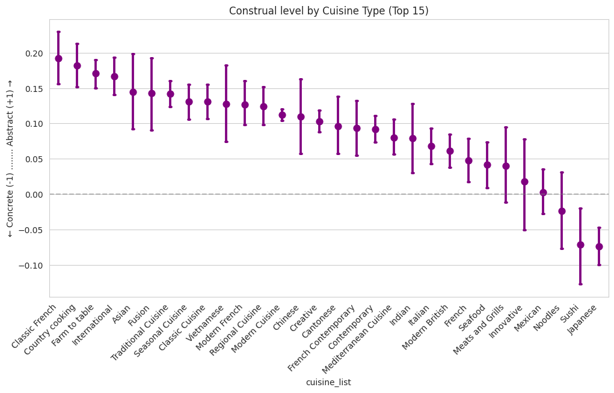
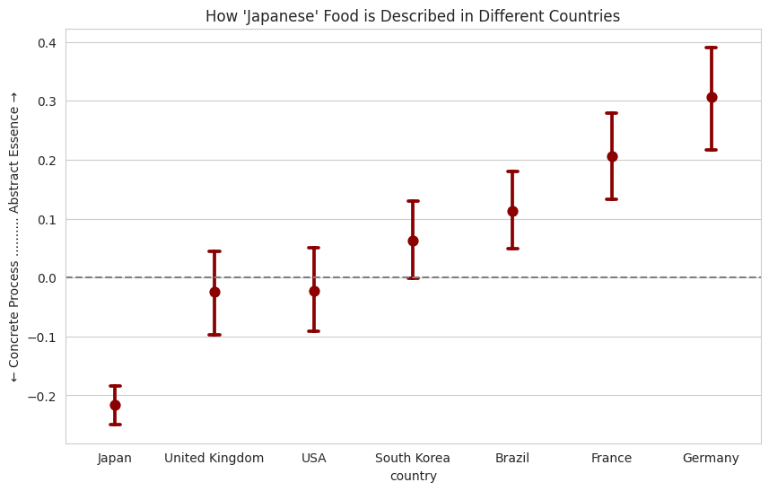

# Counting verbs and adjectives (trial)

> “The farther removed an object is from direct experience, the higher (more abstract) the level of construal of that object.”
>
> (Trope & Liberman, 2010, p. 440)

Scores created January 22, 2026 · spaCy `en_core_web_sm`

A trial analysis. I counted verbs and adjectives in 8,800 restaurant introductions from the English-language Michelin Guide to see how abstractly restaurants around the world are described.

## The idea

I was curious about the non-English words (loanwords) in the Michelin Guide. My assumption is that they make the food feel more distant, as a way for restaurants to establish their prestige. So I wanted to see whether construal level shows up in how the Guide writes about restaurants around the world, using only the grammatical form of the words. The Linguistic Category Model (Semin & Fiedler, 1988) gives one way to do this. Verbs stay close to concrete actions, and adjectives describe more abstract, lasting qualities. So I counted the two forms in each introduction and placed it on a scale from −1 to +1.

```math
\text{score} = \frac{A - V}{A + V + 0.001}
```

A = adjectives and V = verbs in one introduction. The score runs from −1 (only verbs: concrete, process) through 0 (balanced) to +1 (only adjectives: abstract, essence). The 0.001 avoids dividing by zero when an introduction has neither.

## The flow

Every introduction goes through the same steps. Boxes are steps and diamonds are checks. The red loop marks where a check sent me back to rewrite the formula, and the dashed box is a check I have not run yet.


From raw text to the score I kept (v3), then two checks on the group comparisons.

## Three versions of the score

Each version went through checks A, B and C in order. A version that failed a check never reached the next one.

| Version | Formula | A · Spread | B · Extremes | C · Meaning of 0 |
| --- | --- | --- | --- | --- |
| v1, dropped | `V / (A + 0.001)`<br>higher = more verbs | ✗ SD 78, max 5,000. An introduction with 5 verbs and no adjectives scores 5 ÷ 0.001. | *not reached* | *not reached* |
| v2, dropped | `A / (A + V + 0.001)`<br>0 to 1, higher = more adjectives | ✓ Bell-shaped, centered near 0.55. | ✓ Lowest: 5 verbs, 0 adjectives. Highest: 7 adjectives, 0 verbs. | ✗ 0 means *only verbs* and also *nothing to count*. Neutral sits at 0.5. |
| **v3, kept** | `(A − V) / (A + V + 0.001)`<br>−1 to +1, 0 = balanced | ✓ Bell-shaped, centered a little above 0. | ✓ Same order as v2. | ✓ 0 means no lean: balanced, or nothing to count. |

v2 and v3 put introductions in the same order, since v3 ≈ 2 × v2 − 1 whenever there is something to count. Moving to v3 kept that order and moved the neutral point to 0.

## Trial findings around the world

First patterns from a trial run, not tested results. All three figures come straight from my notebook (January 2026). In each one, lower means more concrete and higher means more abstract.


**By country**, for the 15 countries with the most restaurants. Boxes show the spread and red dots the means. Japan sits lowest (mean −0.19, n = 539) and Germany highest (mean +0.20, n = 734).



**By cuisine type**, for the 30 most common cuisine labels (a restaurant with two labels counts under both). Classic French, Country cooking and Farm to table come out the most abstract, and Japanese, Sushi and Noodles the most concrete. Dots are means with 95% intervals.



**Japanese restaurants only**, in the 7 countries with more than 10 of them. The same cuisine is described most concretely in Japan and most abstractly in Germany and France.

Japan and Japanese cuisine come out the most concrete in all three views. Because this is a trial, I read that as a pattern to check. Part of it may come from how the tagger handles Japanese culinary loanwords (check D in the flowchart).

## References

- Honnibal, M., Montani, I., Van Landeghem, S., & Boyd, A. (2020). *spaCy: Industrial-strength natural language processing in Python* [Computer software]. Zenodo. https://doi.org/10.5281/zenodo.1212303
- Semin, G. R., & Fiedler, K. (1988). The cognitive functions of linguistic categories in describing persons: Social cognition and language. *Journal of Personality and Social Psychology, 54*(4), 558–568. https://doi.org/10.1037/0022-3514.54.4.558
- Trope, Y., & Liberman, N. (2010). Construal-level theory of psychological distance. *Psychological Review, 117*(2), 440–463. https://doi.org/10.1037/a0018963

---

Yue Yin · Trial analysis. Scores created January 22, 2026. Part of my Michelin Guide project. See also [Is this a food?](https://yuy123337.github.io/culinary-loanwords/), on culinary loanwords in the Guide.
